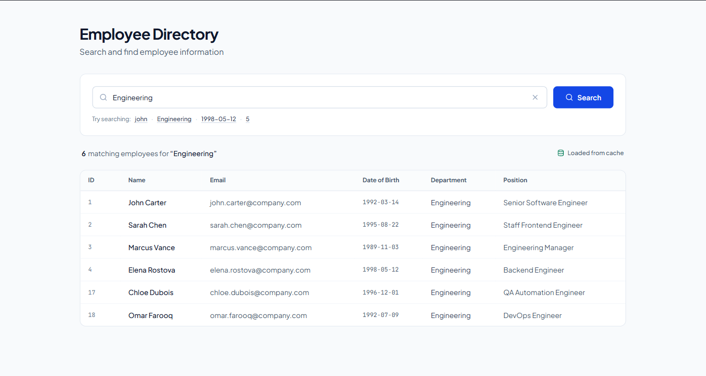
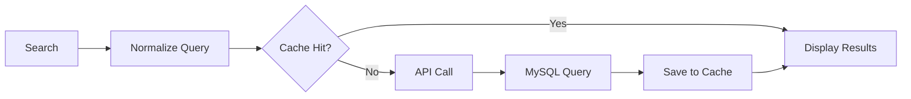

<p align="center">
  
</p>

# Employee Search App

A full-stack employee search application with **React + Vite + Tailwind CSS** on the frontend and **Express.js + MySQL** on the backend.
Features parameterized SQL search, automatic database seeding, and in-memory query caching.

## Prerequisites

- **Node.js** (v18+) and **npm**
- **MySQL Server** (8.0+)
- **Git** (optional — for cloning the repo)


## Setup

1. **Install dependencies** in both folders:

   ```bash
   cd frontend && npm install && cd ../backend && npm install && cd ..
   ```

2. **Create the frontend `.env` file** from the example:

    ```bash
    cp frontend/.env.example frontend/.env
    ```

3. **Create the backend `.env` file** from the example:

   ```bash
   cp backend/.env.example backend/.env
   ```

4. **Edit `backend/.env`** with your MySQL credentials:

   ```env
   DB_HOST=localhost
   DB_USER=root
   DB_PASSWORD=your_password
   DB_NAME=employee_search_db
   DB_PORT=3306
   PORT=3030
   ```

## Database Seeding

No manual SQL import is needed. When the backend starts, it automatically:

1. Reads and executes `database/employee_search_db.sql`.
2. Creates the `employee_search_db` database and `employees` table if they don't exist.
3. Seeds 24 employee records (using `ON DUPLICATE KEY UPDATE`).

The server starts only after seeding succeeds.

## Run the Application

Start the backend and frontend in **two separate terminals**:

```bash
# Terminal 1 — Backend
cd backend && npm run dev
```

```bash
# Terminal 2 — Frontend
cd frontend && npm run dev
```

| Service  | URL                        |
|----------|----------------------------|
| Frontend | `http://localhost:3000`     |
| Backend  | `http://localhost:3030`     |

verify backend running: `http://localhost:3030/api/health` 

## API

### Search Employees

```
GET /api/employees/search?q=john
```

Searchable fields: **ID**, **name**, **email**, **DOB**, **department**, and **position**.

Response:

```json
{
  "success": true,
  "message": "Employees fetched successfully",
  "data": [
    {
      "id": 1,
      "name": "John Doe",
      "email": "john.doe@example.com",
      "dob": "1990-05-15",
      "department": "Engineering",
      "position": "Software Engineer"
    }
  ]
}
```

## Caching Architecture

- Frontend uses a JavaScript `Map` to cache search results in memory.
- The query is trimmed and converted to lowercase before cache lookup.
- **Cache hit** → results are displayed instantly without an API call.
- **Cache miss** → API is called, results are fetched from MySQL, then saved to the cache.
- Empty results (no matches) are cached; failed requests are **not** cached.
- Cache is in-memory only and clears on page refresh.



## Troubleshooting

| Problem | Fix |
|---------|-----|
| **MySQL connection refused / access denied** | Verify `DB_USER`, `DB_PASSWORD`, and `DB_PORT` in `backend/.env`. Ensure MySQL is running. |
| **Port already in use** | Stop the process using the port or change `PORT` in `backend/.env` / the Vite port in `frontend/package.json`. |
| **Missing dependencies** | Run `npm install` inside `frontend/` and `backend/`. |
